<!-- Generated by scripts/render_math.mjs from research_output/revision/manuscript_template.md.in. Edit the template, then rebuild. -->

> **Working manuscript template.** `[AUTHOR]`, `{{...}}`, `[TABLE:...]` and `[FIG:...]` are build markers, not completed results. The [editable LaTeX source](manuscript_template.md.in) is used by the authoring scripts. The final manuscript and filled results are in the permanent archive linked from the repository README.

# Finite step propagation stability and image robustness in graph neural networks for skin lesion classification

[AUTHOR]

## Abstract

Purpose: To determine whether stability of a regional graph propagation operator translates into robust dermoscopic classification, and to separate graph, descriptor and classifier contributions. Methods: This retrospective computational study used the corrected DermaMNIST-C development cohort, its historical lesion-disjoint internal test set, the 1511-image DermaMNIST-E test cohort and an externally acquired 200-image PH2 cohort. We derived finite-step perturbation and conditional prediction bounds for restart propagation and evaluated eight regional architectures, three CNN architectures and four augmentation controls. Each central comparison used ten independently generated lesion-grouped training, tuning and separate calibration partitions. Prespecified development-only sensitivity analyses covered six graph parameters. Corruption experiments included five noise realizations, blur, compression, brightness and contrast changes; factorial graph/node substitutions isolated the affected components. Results: {{abstract_results}} Conclusions: Operator stability is conditional on the graph and encoded features. It cannot establish pixel-level robustness, melanoma screening safety or clinical deployment readiness. The study provides an auditable investigation of this distinction rather than a claim of a new graph-learning principle or a superior diagnostic system.

Keywords: dermoscopy; graph neural network; restart propagation; finite-step stability; calibration; external testing; reproducibility.

## 1 Introduction

Regional relationships are a plausible source of information in dermoscopic classification: similarly colored areas may be spatially separated, while adjacent regions can belong to different visual structures. Graph neural networks make these relationships explicit through node descriptors and weighted edges [1-3]. Their usefulness depends on how the image is represented and how the graph is constructed. A stable propagation matrix does not, by itself, make a learned image classifier insensitive to acquisition noise or distribution shift.

Skin-lesion systems have combined segmentation with CNN classification [4], developed lightweight MobileNet architectures [5] and examined a broad range of machine-learning pipelines [6]. More recent work has attached CNN embeddings to superpixel graphs [7], combined clinical metadata graphs with vision transformers [8] and used multiscale superpixel relations for annotation-free segmentation [9]. Regional graphs, similarity kernels and personalized restart are therefore established ideas. Our contribution is an explicit finite-step analysis linked to component-controlled experiments and measured failure mechanisms, not the first application of GNNs to dermatology.

The project documents on AI-assisted skin-disease diagnosis and skin-lesion methodology motivated an economical image-specific graph strategy. Their proposed mobile interface, clinical recruitment, human-reader comparison and hospital validation are research plans, not executed components of the present study. Related local codes and unpublished drafts informed the implementation audit; they are not cited as evidence of diagnostic performance.

Data integrity is equally important. HAM10000 provides heterogeneous diagnostic reference standards and repeated images of some lesions [10]. Its lightweight MedMNIST derivative is intended for benchmarking rather than clinical use [11]. Documented overlap and duplication motivated corrected DermaMNIST partitions [12,13]. We use lesion-grouped development and audit cross-partition image identities, while distinguishing lesion-level safeguards from unverified patient independence.

We address three questions. First, what stability statement applies to the actual four-step network and its prediction head, rather than only an infinite-step fixed point? Second, how do topology, edge weights, local-difference descriptors and restart parameters affect performance under controlled training? Third, when an image changes, how much of the observed failure is attributable to its graph versus its encoded node features? A separate PH2 cohort [14] and the untouched DermaMNIST-E test protocol examine transfer beyond the original internal test set. These evaluations do not replace prospective workflow or smartphone-camera testing.

## 2 Materials and evaluation design

### 2.1 Data sources and reference standards

DermaMNIST-C contains 10015 native 28 by 28 RGB images in seven categories: actinic keratosis and intraepithelial carcinoma (AKIEC), basal cell carcinoma (BCC), benign keratosis-like lesions (BKL), dermatofibroma (DF), melanoma (MEL), melanocytic nevi (NV) and vascular lesions (VASC). AKIEC is retained as the combined source label; it is not renamed as a separate squamous-cell-carcinoma category. Source labels may be based on histopathology, follow-up, expert consensus or other source-defined verification, and are not uniformly histopathologically confirmed [10-12].

[TABLE:cohorts]

The original 8215 training and 573 tuning images form an 8788-image development pool. The historical 1227-image test set, comprising 1149 unique lesion identifiers, remains outside all revised fitting, tuning and calibration. It contains only eight DF, 17 VASC and 70 MEL images, making classwise uncertainty essential. The historical internal test had been examined in the preliminary study; the revised comparisons on this cohort are consequently exploratory, not a newly untouched confirmatory test.

The official DermaMNIST-E test set contains 1511 images with the same seven-label convention. Its training and tuning partitions are not used for model fitting. Source image identifiers and native pixel hashes are checked against all DermaMNIST-C images before testing. Available E metadata do not provide lesion or patient identifiers, so its uncertainty is estimated by image resampling and its evaluation is described as a benchmark-transfer test, not as proof of independent clinical-center validation.

PH2 was acquired at the Dermatology Service of Hospital Pedro Hispano, Matosinhos, Portugal [14]. The 200 images comprise 80 common nevi, 80 atypical nevi and 40 melanomas. Images and the original diagnosis table were retrieved through a public mirror because the legacy official download link returned an error. Image identifiers, all file paths and the 80/80/40 diagnosis counts were verified against the source documentation. The original clinical diagnosis field is the reference standard; pathology is used only where supplied by the dataset. PH2 images are resized to 28 by 28 using bicubic interpolation without cropping or segmentation. No PH2 image, label or mask is used to fit a network, normalization, temperature or decision threshold.

All images in the specified releases are retained; there is no additional image-quality or demographic exclusion. Image and diagnosis arrays contain no missing values. Age and sex metadata are descriptive only, with missing values retained as unknown rather than imputed. E and PH2 provide no comparable individual demographic or patient-linkage fields for this analysis. Sample size follows the available releases without a formal power calculation; the very small minority-class cohorts support exploratory benchmarking rather than reliable subgroup or screening claims. Individual recruitment dates, complete device histories and original annotation-rater reliability records are unavailable in the analysis files.

The frozen seven-class model is evaluated on PH2 as a melanoma-versus-nevus task. Its unmodified MEL probability is used for ROC analysis, and its seven-class argmax is converted to a melanoma indicator for operational sensitivity and specificity. Common and atypical nevi are both negatives. We do not retrain a PH2 classifier, renormalize the MEL/NV probabilities or compare binary PH2 F1 directly with seven-class benchmark macro F1.

### 2.2 Identity audits and development partitions

Metadata label order is checked against the NPZ label arrays. The original C splits have no shared lesion identifier and no exact pixel-hash intersection. E test images have no shared source image identifier or exact native pixel hash with the C development pool or historical C test. PH2 contains 200 distinct raw-image hashes and no exact resized-image hash matching any C image. Normalized cross-correlation is also used as a near-image screen: {{overlap_results}}. These checks do not prove patient independence or rule out every transformed near-duplicate. PH2 and E do not expose the patient identifiers needed for such a claim.

For each of ten seeds, a shuffled stratified seven-fold group partition separates approximately one seventh of the C development pool for tuning. A shuffled six-fold group partition then separates approximately one sixth of the remaining images for calibration. The rest are used for training. Every grouping unit is a lesion identifier. Training, tuning and calibration lesion sets are disjoint, and their image counts and class distributions are retained for every repetition. {{partition_results}}. All compared architectures use the same partitions for a given seed. Normalization and class weights are estimated only from that repetition's training images.

### 2.3 Prespecified scope and endpoints

The evaluation configuration, sensitivity ranges and descriptor-control addendum were recorded before new test inference. The principal endpoint is macro F1; balanced accuracy, macro average precision, ROC AUC, classwise errors, calibration and computational cost are complementary endpoints. We report performance variation across ten fitted repetitions separately from test-sampling confidence intervals for a fixed probability ensemble. No internal or external test result is used to choose a hyperparameter, checkpoint, calibration temperature or referral threshold.

## 3 Regional graph models

### 3.1 Node descriptors

Each image is divided into a fixed seven by seven grid of four by four pixel regions. The nodes are regular regions, not SLIC superpixels [15], anatomically verified lesion compartments or segmentation masks. RGB means, population standard deviations, mean absolute horizontal and vertical neighboring-pixel differences, normalized coordinates and radial distance form a 15-dimensional descriptor. Pixel values are in [0,1].

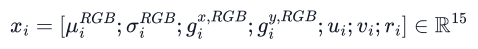

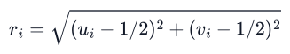

Per-coordinate training means and population standard deviations standardize these descriptors. The same statistics are applied to tuning, calibration and every test cohort. A local-variation proxy is defined from the absolute differences. High values may reflect pigmentation, hair, highlights or image noise; the proxy is neither a clinical boundary label nor diagnostic uncertainty.

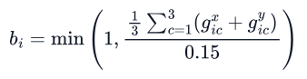

### 3.2 Topology and edge weights

Candidate edges combine four-neighbor grid adjacency with the symmetrized k nearest neighbors of each node in raw RGB-mean space. Self-neighbors are excluded from the kNN search. Ties are resolved by the implemented array ordering; claims of raw-image rotation invariance are not made. For the full graph, the candidate indicator and contrast-dependent weights are

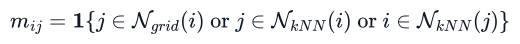

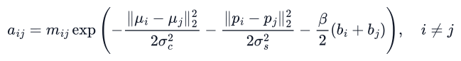

Here p is the node-center coordinate. The retained reference settings are k = 4, color scale 0.25, spatial scale 0.4 and penalty strength 1.5. The penalty-free contrast graph uses beta = 0. These settings are examined in development-only sensitivity experiments; retaining them for the test comparisons is a controlled reference choice, not evidence that they are optimal or clinically meaningful.

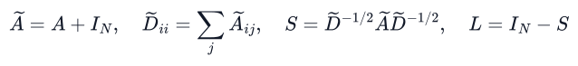

Unit-weight self-loops give positive degrees. The same raw image determines both the descriptors and graph, and no node is linked to a different image or person. Grid-only and kNN-only controls restrict the candidate topology while retaining the weighting formula. A constant-weight control uses the identical full candidate topology with all non-self weights equal to one, separating topology from weighting.

### 3.3 Encoder and finite-step propagation

A shared two-layer ReLU MLP maps each 15-dimensional node to 32 dimensions. Restart propagation starts at its output Z and applies four updates with alpha = 0.2. Graph weights are image-dependent but are not learned by backpropagation in these experiments.

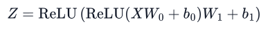

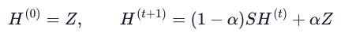

For a fixed image graph, precomputing the polynomial Q is exactly equivalent to these updates. It does not introduce interactions between training and test images.

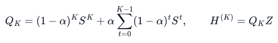

Mean and coordinatewise maximum pooling are concatenated. A 64-to-32-to-7 MLP with ReLU and dropout 0.15 supplies logits. Dropout is disabled for all evaluations.

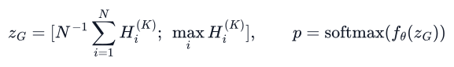

[FIG:fig01_pipeline|Image-specific graph construction and the implemented finite-step classifier. The separate graph and node paths permit factorial substitution without refitting model parameters.]

### 3.4 Controlled architectures and fitting

[TABLE:architectures]

All regional encoders and heads retain 3879 trainable parameters. The descriptor controls disable the six local-difference coordinates after standardization while preserving RGB statistics, coordinates and radius. They are evaluated in both the graph-free architecture and the full penalized graph architecture. The latter retains the graph's variation weights, so only the encoder descriptor changes. Equal parameter counts do not imply identical effective capacity when input coordinates are disabled.

The small CNN has three 3-by-3 convolutional blocks with 16, 32 and 32 channels, max pooling after the first two blocks and the same pooled classification head. Standard torchvision ResNet-18 [16] and MobileNetV3 Small [17] are trained from scratch with seven outputs on the same native 28-by-28 inputs. No ImageNet weights or external pretraining are supplied to these primary references. They test the specified matched protocol and are not claimed to reproduce published state-of-the-art transfer-learning results or optimized deployments. A separate additional frozen pretrained reference, with different preprocessing, is described in the supplementary analysis.

The ten central architectures and the additional graph descriptor control use uniformly sampled right-angle rotations and horizontal flips. Images are transformed directly. For regional networks the corresponding node permutation, horizontal/vertical-difference exchange and coordinate assignment are applied; the constructed graph is permuted consistently. Descriptor equivalence with independently transformed images is verified numerically. Reconstruction of graphs with tied nearest-neighbor distances need not be identical. Matched no-augmentation controls are fitted for the graph-free, both full weighted graphs and small CNN architectures.

AdamW uses learning rate 0.002, weight decay 0.0001, target minibatch size 256, a maximum of 60 epochs and patience ten. The checkpoint with greatest tuning macro F1 is retained. Each model is fitted independently for seeds 101, 211, 307, 401, 503, 601, 701, 809, 907 and 1009. Training uses square-root inverse-frequency class weights from that repetition's training subset, with minibatch normalization matching the executed loss.

Experiments use Python 3.12, PyTorch 2.14.1 with torchvision 0.29.1 on CPU, NumPy 2.5.4 and scikit-learn 1.9.1. Exact package versions and the environment manifest are supplied with the code. Geometric augmentation is shared per minibatch, as implemented; it is not an independent random transform for each image.

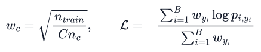

After checkpoint selection, each network's temperature is optimized using only its separate calibration cohort, minimizing unweighted negative log likelihood over temperatures from 0.1 to 10 [18]. The calibration data are not used for early stopping. Ensemble probabilities are simple arithmetic means of the ten raw or separately calibrated network probabilities.

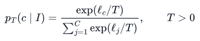

## 4 Stability of the implemented prediction mapping

### 4.1 Fixed point and finite-step response

Assume a finite, symmetric, elementwise nonnegative adjacency with positive degrees. The normalized S is similar to a row-stochastic matrix and is symmetric, hence its real eigenvalues lie in [-1,1] and its spectral norm is at most one. The normalized Laplacian L is positive semidefinite with eigenvalues in [0,2]. For 0 < alpha <= 1 and a fixed encoded Z, the restart update has contraction factor at most 1-alpha. At alpha = 1 this factor is zero and the representation immediately remains Z. Its fixed point, convergence bound and equivalent strictly convex problem follow from established personalized propagation [2].

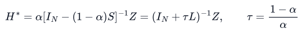

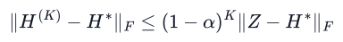

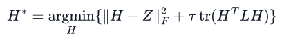

Proof. The difference of two restart updates is 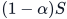 times the preceding difference. The operator norm yields contraction and the geometric inequality. The smallest eigenvalue of 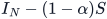 is at least , so the inverse exists. Differentiating the objective gives 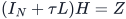, whose positive-definite Hessian establishes a unique minimizer. These statements concern propagation, not optimizer convergence or clinical classification accuracy.

For an L eigenvalue lambda, the fixed-point and actual K-step responses are different:

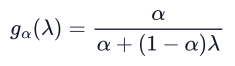

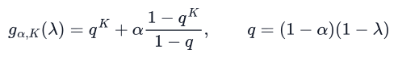

The denominator is nonzero when alpha is positive. With alpha = 0.2, K = 4 and lambda = 2, the finite-step gain is 0.4752, whereas the fixed-point gain is approximately 0.1111. The implemented short filter therefore cannot be represented by the infinite-step response alone. Define graph energy as 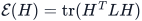 and let U contain the orthonormal eigenvectors of L. At the fixed point, graph energy cannot increase:

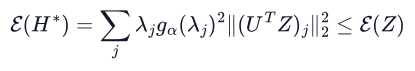

The zero-frequency mode of a connected normalized graph is proportional to the square root of its degree vector; it is not necessarily a constant raw feature. Consistent node reindexing and its limits are addressed in Section 4.5.

### 4.2 Finite-step graph and feature perturbations

Proposition 1. Let S and S' satisfy the same operator-norm condition, set 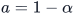, and start both recurrences at the same Z. The finite-step mapping satisfies

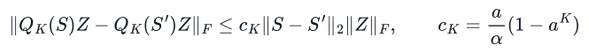

Proof. Every iterate of the second recurrence has norm at most the norm of Z, because its update is a convex combination of an operator contraction and Z. Let 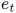 denote the Frobenius norm of the difference between the iterates. Then 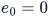 and 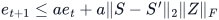. Summing the geometric series gives . For the implemented alpha = 0.2 and K = 4, ; the corresponding infinite-step coefficient is four. This bound directly covers the deployed polynomial rather than only its limiting resolvent.

Proposition 2. Since the norm of 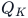 is at most one, simultaneous feature and graph changes satisfy

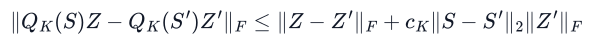

Proof. Add and subtract 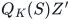, apply the operator-norm bound to the feature difference and apply Proposition 1 to the remaining graph difference. The statement separates the two inputs but does not bound either by a small pixel perturbation. A deterministic kNN graph may change its candidate topology discontinuously.

### 4.3 Conditional logits and probability bounds

Let 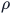 concatenate mean and coordinatewise maximum pooling, and let f be the evaluation-mode two-layer classifier. Under the Frobenius-to-Euclidean norms, the pooling Lipschitz constant is at most 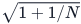. The mean component contributes 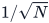; each maximum component changes by no more than the Euclidean norm of that feature column. With 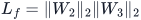, the logits satisfy the conditional bound

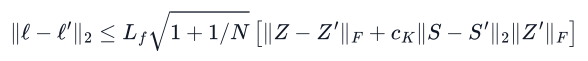

The encoder is itself Lipschitz in its standardized descriptor matrix with constant , because ReLU is nonexpansive. This does not make the hand-crafted image descriptors insensitive to noise. The softmax Jacobian has Euclidean operator norm at most one half, giving

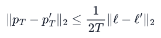

If the clean logit margin between its highest and second-highest scores exceeds twice the right-hand side of the logit inequality, its argmax is unchanged. This is a sufficient prediction-invariance condition, not a condition for correct diagnosis. Weight norms and observed changes in S and Z remain part of the premise. No unconditional image-to-probability robustness certificate is claimed.

For the ten-model probability ensemble, let 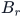 be model r's right-hand side in the logit bound. The triangle inequality gives 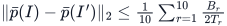. This remains conditional on each encoded-feature and graph change. A margin condition on a single model's logits does not automatically establish ensemble invariance.

### 4.4 A conditional nearest-neighbor topology statement

Let every node's RGB mean change by at most epsilon in Euclidean norm. Each pairwise color distance changes by at most 2 epsilon. If, for a node, the gap between its (k+1)th and kth non-self distances exceeds 4 epsilon, its kNN set cannot change:

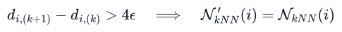

Proof. A candidate inside the clean set can move upward by at most 2 epsilon, and an outside candidate downward by at most 2 epsilon. A gap greater than their combined change preserves the ordering at the cutoff. Failure of this sufficient condition does not prove a neighbor change. We therefore measure actual adjacency changes as well as spectral and feature distances. This condition explains why graph topology is not globally Lipschitz in raw pixels and is deliberately separated from finite-operator stability.

### 4.5 Conditional permutation equivariance

For a permutation matrix P, the provided descriptor/graph pair transforms as  and . A shared row encoder gives 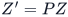. Polynomial propagation then satisfies

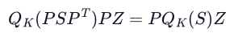

Proof. Each power obeys 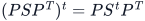, so conjugation commutes with the polynomial. Mean and coordinatewise maximum pooling ignore row order; the pooled classifier is therefore invariant to this consistent reindexing. Positional attributes must follow their nodes. Independently rebuilding a color-kNN graph with index-resolved ties need not produce the same conjugate graph. Neither raw-image rotation invariance nor clinical scale invariance follows from this conditional statement.

[FIG:fig02_theory|Infinite- and finite-step spectral responses, the finite graph-perturbation coefficient and numerical checks for the actual four-step operator.]

## 5 Statistical analysis and diagnostic experiments

### 5.1 Metrics and uncertainty

Macro F1 and balanced accuracy assign equal weight to the seven categories. One-versus-rest ROC AUC and average precision assess probability ranking. Overall accuracy is interpreted alongside the 77.26 percent majority-class accuracy of the historical C test set. Classwise sensitivity, specificity, precision and F1 are reported with uncertainty, particularly for melanoma and the small DF/VASC cohorts.

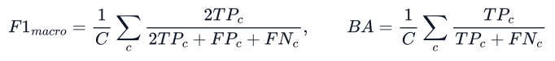

Training/development variation is the mean and sample standard deviation of ten fitted networks with independently sampled grouped partitions. Conditional test-sampling uncertainty is estimated from 1000 shared bootstrap draws. C images are resampled as lesion clusters, preserving all views of a sampled lesion. E and PH2 are resampled by image because their public metadata do not supply reliable group identifiers. These intervals do not incorporate the complete uncertainty of model development or establish patient-level external independence.

All seven classes are retained in macro metrics, with zero contribution when a bootstrap class denominator is zero. Classwise intervals omit undefined denominator draws; precision intervals are marked not estimable if every draw has no positive predictions. Point precision uses the explicitly disclosed zero-division convention. These choices matter particularly for the majority-only scratch MobileNet and the small DF cohort.

Ensemble comparison intervals use the same draws for both models. They are exploratory, unadjusted for multiple comparisons and conditional on the fitted ensemble. Point estimates or intervals excluding zero are not presented as confirmatory superiority evidence. No significance claim is based on choosing the most favorable metric or training seed.

### 5.2 Calibration and abstention

Negative log likelihood and the multiclass Brier score complement top-label ECE. Brier is summed over classes without division by seven. Top-label ECE uses ten equal-width confidence bins. Classwise binary ECE compares each class probability with its one-versus-rest observed frequency; classwise reliability curves and cluster-resampled intervals are included. Rare-class ECE can be small because most observations are negative and must be interpreted alongside class discrimination and sensitivity.

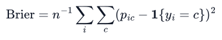

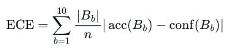

For exploratory selective prediction, the 20th percentile of pooled out-of-fitting calibration confidences sets a fixed abstention threshold. Each pooled prediction comes from a model that excluded that image from its training and tuning, although an image can occur in different calibration repetitions. The threshold is transferred unchanged to the test cohorts. Melanoma sensitivity/specificity tradeoffs use a separate calibration-derived MEL threshold targeting 95 percent calibration sensitivity. Abstention, an argmax classification and a threshold-triggered melanoma referral are different decisions; none is treated as a validated clinical workflow.

Pooling repeated single-model calibration predictions does not create a separate ensemble-calibration dataset. Their confidence distribution differs from that of an averaged ensemble, so neither 80 percent coverage nor 95 percent melanoma sensitivity is guaranteed after averaging or transfer.

### 5.3 Development-only sensitivity

One-factor-at-a-time sweeps use three independent development seeds, 1201, 1301 and 1409. Prespecified values are k in {2,4,8}, alpha in {0.1,0.2,0.5}, K in {1,4,8}, color scale in {0.125,0.25,0.5}, spatial scale in {0.2,0.4,0.8} and beta in {0,0.5,1.5,3}. The shared default configuration is fitted once per seed, giving 42 development-only fits. The same training recipe and geometric augmentation are used. Because the best checkpoint is selected by tuning macro F1, tuning-set performance is descriptive and optimistic; it is not an external-test estimate. No sweep result is used to redesign the frozen test comparisons.

In each sweep, operator change under a fixed low-noise perturbation is measured on 64 tuning images using the spectral norm of the difference between the clean and perturbed image operators. The primary mechanistic experiments additionally measure candidate-edge changes, normalized descriptor and encoded-feature differences. This jointly assesses sensitivity of graph structure and of the representation instead of attributing all failures to one without an ablation.

### 5.4 Corruptions and factorial component substitutions

Gaussian noise at standard deviations 0.02, 0.05 and 0.10 in RGB [0,1] is generated independently for five seeds. Deterministic tests use Gaussian blur scales 0.5 and 1.0, JPEG quality 40 and 80, brightness multipliers 0.75 and 1.25, and contrast multipliers 0.75 and 1.25 about the per-image mean. Values are clipped to [0,1] and quantized to uint8. The same perturbed images are evaluated across models without refitting weights or normalization.

The factorial experiment fixes all trained parameters and compares A, clean graph with clean nodes; B, corrupted graph with clean nodes; C, clean graph with corrupted nodes; and D, corrupted graph with corrupted nodes. Both mean macro F1 changes and paired lesion-cluster intervals are reported. This isolates the two pathways under the tested substitutions; it is not a clinical causal experiment and may include graph/feature interaction.

Operator distances and trained feature/head-bound checks use the first 64 native C test images as a fixed diagnostic subset. Relative descriptor and encoded-feature Frobenius norms are computed over that subset tensor and averaged across the ten checkpoints. Candidate-edge Jaccard similarity and factorial classification metrics use the full 1227-image test set. This subset is not claimed to represent the full clinical population.

### 5.5 Computational measurements

Batch-one CPU timing separates encoded-image decoding, descriptor/graph preparation and network inference. Twenty warm-up evaluations precede 100 measured images in a fresh model process. Median and 95th-percentile times and process peak memory are reported with the processor/runtime information. Process memory includes the Python and library runtime and is not isolated activation memory. Training timings under concurrent jobs are not used to rank model efficiency. No mobile-device timing, energy or deployment claim is made.

## 6 Results

### 6.1 Component and architecture comparisons

[TABLE:internal_results]

{{internal_results_text}}

[FIG:fig03_components|Matched protocol comparisons across ten independent grouped development repetitions. Error bars summarize training/partition variation; fixed-ensemble test intervals are reported separately.]

The constant-weight full graph has the same candidate topology as the weighted full graph, while the grid-only and color-kNN-only controls isolate candidate relations. The two gradient-descriptor controls isolate the local-difference coordinates in both graph-free and graph-based encoders. {{component_results_text}}. These comparisons concern the executed low-resolution, from-scratch protocol; they do not establish a universal ranking of graph and CNN architectures.

[TABLE:augmentation_results]

{{augmentation_results_text}}

### 6.2 Classwise errors and melanoma decisions

[TABLE:classwise_results]

{{classwise_results_text}}

[FIG:fig04_errors|Classwise sensitivity with lesion-cluster uncertainty and the full internal-test confusion matrix. Melanoma misses and rare-class sample sizes are retained explicitly.]

{{referral_results_text}}

### 6.3 Separation of graph and node sensitivity

[TABLE:isolation_results]

{{isolation_results_text}}

[FIG:fig05_isolation|Factorial graph/node substitutions and measured changes in graph operators and encoded node features. All trained parameters are held fixed.]

The component substitutions show the pathway responsible under these perturbations more directly than an intact-network corruption curve alone. They do not establish that the local-variation proxy identifies pathological boundaries or that the same pathway dominates every camera artifact. {{topology_results_text}}

### 6.4 Multiple corruption trials

{{robustness_results_text}}

The native scratch MobileNet ensemble assigns every C image to NV, including under the tested corruptions. Its nearly flat macro F1 curve is therefore a failed majority-class decision rule, not evidence of useful robustness. An additional frozen pretrained reference is evaluated separately in the supplementary analysis.

[FIG:fig06_robustness|Five independent Gaussian-noise realizations and additional blur, compression, brightness and contrast tests. Confidence intervals account for shared internal-test lesions and, for noise, the sampled realizations.]

### 6.5 Calibration and selective prediction

[TABLE:calibration_results]

{{calibration_results_text}}

[FIG:fig07_calibration|Top-label and classwise reliability evidence. Melanoma calibration is interpreted separately from the majority NV category and from overall ECE.]

{{selective_results_text}}

### 6.6 Benchmark transfer and source-external testing

[TABLE:external_results]

{{external_results_text}}

[FIG:fig08_external|Seven-class benchmark transfer to DermaMNIST-E and binary melanoma evaluation on the separately acquired PH2 cohort. The two tasks are not combined into a single macro F1 ranking.]

These results extend the original single-benchmark experiment, but the PH2 sample remains small and selected, its images are downsampled, and public patient identities are unavailable. No demographic, device or institutional coverage claim is inferred from two small open-data test protocols.

### 6.7 Parameter sensitivity and numerical verification

{{sensitivity_results_text}}

[FIG:fig09_sensitivity|Development-only one-factor sensitivity analyses with three independent grouped partitions. No displayed parameter choice was selected using a test cohort.]

{{theory_results_text}}

The numerical checks compare the implemented recurrence, independently formed polynomial and eigendecomposition; assess finite graph/feature inequalities and pooling bounds; and test descriptor augmentation against transformed images. Analytical proofs establish the conditional statements. Finite-sample numerical agreement checks implementation fidelity, not clinical validity.

### 6.8 Computational cost

[TABLE:runtime_results]

{{runtime_results_text}}

## 7 Discussion

The central distinction is between three levels of stability. A normalized restart operator is stable for a fixed encoded input. Its finite-step graph sensitivity can be bounded without invoking the limiting fixed point. The complete image classifier, however, depends on both an image-derived topology and an encoder that receives noise-sensitive descriptors. Our factorial substitutions and graph-structure measurements connect those levels empirically. A spectral theorem cannot be read as a clinical robustness guarantee.

The regional design is an economical test bed for this question. It preserves a small number of trainable parameters and gives direct access to graph and descriptor perturbations. Its cost is the loss of fine visual texture at 28 by 28 pixels and reliance on color/difference statistics. These regions cannot resolve all pigment networks, lesion margins or artifacts at clinically meaningful scales. The beta term can attenuate meaningful visual changes as well as unwanted variation. Its value must be judged from controlled results, not its boundary-oriented motivation.

{{discussion_results_text}}

The added ResNet-18 and MobileNetV3 comparisons make the architectural reference set stronger under a shared fitting protocol. They are trained from scratch, with no architecture-specific extensive optimization or external pretraining. Differences in capacity, normalization and network nonlinearities remain. The results therefore compare these executed systems, rather than asserting that a small regional graph outperforms the best possible image backbone. Learned regional embeddings and high-resolution superpixels are reasonable future alternatives, but they were not silently substituted for the measured descriptor model.

Separate calibration cohorts reduce the dependence created when the same small tuning partition is used for both checkpoint selection and temperature fitting. Repeated lesion-grouped partitions and ten repetitions also improve the assessment of training variability. They do not create ten independent patient populations. Test-cluster confidence intervals remain conditional on the trained ensemble, and repeated calibration cohorts overlap across repetitions. Rare-class reliability and referral thresholds need substantially larger, clinically representative cohorts.

External PH2 testing and the independent E benchmark protocol address the original single-test limitation without establishing prospective reliability. PH2 is a binary melanocytic cohort, not a seven-disease prevalence sample. Its standardized acquisition conditions and small size differ from smartphone imaging. E supplies no public lesion grouping metadata. Both are evaluated at reduced resolution, and neither supplies the patient-level linkage needed to certify all cross-dataset identity assumptions. The exact-copy and near-image screens are useful safeguards, not substitutes for such identities.

Discrimination, classification, calibration and referral must remain distinct. High ROC AUC describes ranking across thresholds; it does not imply high melanoma sensitivity under argmax. Low aggregate ECE can coexist with classwise error or worse NLL than a comparator. High accuracy among accepted images may reflect refusal of difficult melanoma cases. No treatment advice, autonomous diagnosis or validated referral service is proposed. Separate clinical-photograph tasks, such as erythema-migrans recognition [21], involve different modalities and disease spectra and cannot be covered by this pigment-lesion benchmark.

Reporting follows the transparency principles of TRIPOD+AI [19] and CLAIM 2024 [20], including data partition scope, reference standards, selection, calibration, uncertainty, external testing and failure cases. The accompanying item-level mapping identifies non-applicable or unmet clinical requirements. These reporting checklists are not certificates of scientific quality, clinical approval or clinical utility.

## 8 Conclusion

{{conclusion_results_text}} The scientific contribution is an auditable, finite-step and component-controlled assessment of the gap between propagation stability and image-level robustness. Clinical deployment, universal architectural superiority and a novel personalized-PageRank principle are not claimed. Higher-resolution independent cohorts, learned regional features and prospective decision-workflow evaluation remain necessary before diagnostic use.

## Declarations

Author and correspondence: Caglar Uyulan, Faculty of Engineering and Architecture, Department of Mechanical Engineering, İzmir Katip Celebi University, İzmir, Türkiye. Email: caglar.uyulan@ikcu.edu.tr.

Funding: The author declares that no external financial support was received for this research.

Author contributions: Caglar Uyulan is the sole author responsible for conceptualization, methodology, software, validation, formal analysis and manuscript preparation.

Competing interests: The author declares no competing interests.

Ethics and consent: This retrospective computational study reuses previously published, publicly accessible benchmark images and metadata. No new participants were recruited, no private clinical records were accessed, and no new ethics-approval identifier or consent collection is claimed. Source data permissions and reference standards are described in their original publications. PH2 redistribution and commercial use are prohibited; its images and original annotation files are excluded from the distributed reproduction archive.

Data and code availability: Exact data-source URLs, versions, hashes, fitting code, configurations, checkpoints, prediction outputs, uncertainty scripts and editable figure sources accompany the submission in Supplementary Archive S1. The corrected C/E releases are available at the verified Zenodo record [13]. PH2 retrieval provenance and preprocessing scripts are supplied, but restricted image data are not redistributed. No fictitious public repository, archive DOI or prospective registration number is provided; a public code deposit is a separate author-controlled publication step.

AI assistance: Generative AI assistance was used for code and manuscript preparation. Reported measurements come from executed experiments and independent arithmetic and implementation checks. The named author is responsible for the final scientific interpretation and submission.

Registration and involvement: The study was not prospectively registered and involved no patient or public consultation. Frozen local configurations document the revised comparisons; they are not a prospective clinical registration.

## References

[REFERENCES]

## Supplementary methods and interpretive illustrations

[FIG:fig10_examples|Deterministically selected correct and incorrect minority-class cases from the internal test cohort, with reference and predicted labels. Native image resolution is retained; enlargement does not recover clinical texture.]

[FIG:fig11_topology|Matched clean and noisy images with their rebuilt graph connections. The local-variation proxy is a numerical image statistic, not a validated lesion boundary.]

[TABLE:sensitivity_details]

### Additional exploratory ImageNet reference

All ten native-resolution MobileNetV3 fits selected epoch one and failed to improve tuning macro F1 beyond the majority-category level. Their flat corruption curve is consequently a constant classifier outcome, not evidence of robustness. To avoid presenting this failure as a competitive lightweight system, an additional exploratory reference freezes the official MobileNetV3 Small IMAGENET1K_V1 backbone and fits ten 576-to-7 linear heads (4039 learned parameters) on the same grouped development partitions. The backbone, including its batch-normalization statistics, stays in evaluation mode. Features are standardized using each training subset; head fitting and separate temperature calibration use the same optimizer, stopping criterion and calibration protocol. No augmentation is applied to this additional reference.

The official preprocessing resizes the original 28-pixel images to 256, takes a central 224 crop and applies ImageNet channel normalization. This adds no recovered image detail. The external ImageNet weights and different preprocessing prevent attribution of any difference to architecture alone. This extension was motivated by development fitting failure and recorded before its new test inference; it does not replace the 150 prespecified primary/control fits. Source weights, their hash, fitted heads, logits and all 23 corruption predictions accompany S1. There are 160 primary/control/additional head fits plus 42 development-only sensitivity fits in the complete package.

[TABLE:transfer_reference]

{{transfer_results_text}}

[FIG:fig12_transfer|Additional fixed ImageNet MobileNetV3 reference, evaluated separately from the primary from-scratch protocol. Corruption intervals are conditional lesion/realization bootstrap intervals. External pretraining, preprocessing and the unaugmented head recipe differ from the primary models.]

[REPORTING_MAP]
